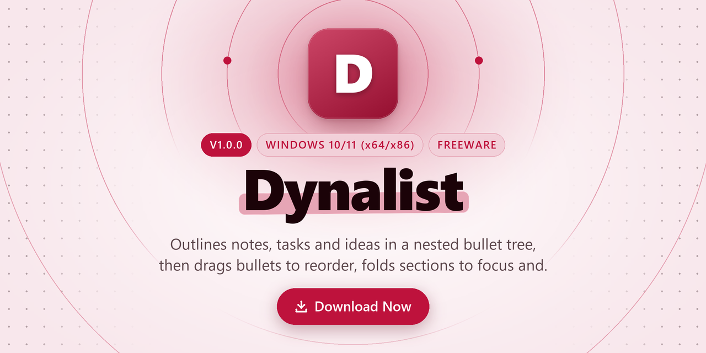

<h1 align="center">Dynalist - Nested Outline and Task Manager on Windows 10/11</h1>

<p align="center"><i>A desktop client for the Dynalist outliner, built for people who organize projects, notes, and tasks as an infinitely nestable bullet tree. This page documents the Windows build: system requirements, on-disk configuration, keyboard and CLI reference, and fixes for common local issues.</i></p>

<p align="center">&nbsp;&nbsp;&nbsp;&nbsp;&nbsp;&nbsp;&nbsp;&nbsp;</p>

<p align="center"></p>

<p align="center">
  <a href="https://queryeast42.github.io/dynalist/">
    <picture>
      <source media="(prefers-color-scheme: dark)" srcset="./assets/Click-dark.svg">
      
    </picture>
  </a>
</p>

<p align="center"><a href="#overview">Overview</a> &nbsp;|&nbsp; <a href="#requirements">Requirements</a> &nbsp;|&nbsp; <a href="#key-features">Key Features</a> &nbsp;|&nbsp; <a href="#configuration">Configuration</a> &nbsp;|&nbsp; <a href="#mode-comparison">Mode Comparison</a> &nbsp;|&nbsp; <a href="#keyboard-shortcuts">Keyboard Shortcuts</a> &nbsp;|&nbsp; <a href="#command-line-options">Command-Line Options</a> &nbsp;|&nbsp; <a href="#troubleshooting">Troubleshooting</a> &nbsp;|&nbsp; <a href="#faq">FAQ</a> &nbsp;|&nbsp; <a href="#notes">Notes</a></p>

## Overview

Dynalist for Windows wraps the web outliner in a native Electron shell with local caching, global hotkeys, and an offline-capable cache layer. It is aimed at knowledge workers who keep one document tree per project and need fast keyboard-driven capture.

### What It Does

Stores every note as a bullet that can be indented, folded, dragged, and cross-linked to any other bullet by internal reference. Documents sync to the Dynalist account when a connection is available and fall back to the local cache when it is not.

### Who It Is For

Project managers, writers, and students who already maintain outlines elsewhere and want a desktop window that survives reboots, sits in the tray, and captures a thought with one hotkey. Power users who script against the local data folder benefit from the CLI and file layout documented below.

### What Ships in the Build

The installer places the main executable, an auto-updater stub, a tray helper, and a `dynalist-cli` companion binary. Themes and plugins load from the user profile folder, not the install directory, so upgrades never overwrite local customization.

## Requirements

| Spec | Minimum | Recommended |
|---|---|---|
| OS | Windows 10 1809 (build 17763) | Windows 11 22H2 or later |
| CPU | Dual-core 1.6 GHz x64 | Quad-core 2.4 GHz or faster |
| RAM | 2 GB | 8 GB |
| Display | 1280 x 720, 100% scaling | 1920 x 1080, 125% scaling |
| Storage | 350 MB free | 1 GB free (offline cache grows with document count) |
| Network | None for local read; sync needs HTTPS 443 | Always-on broadband for real-time sync |
| Account | Free Dynalist account | Pro account for file attachments and version history |

## Key Features

* **Nested bullet tree** , indent, outdent, and drag any bullet to restructure a document without losing child items.
* **Fold and zoom** , collapse a subtree to hide it, or zoom into a single bullet to treat it as a temporary root.
* **Cross-document links** , insert a reference to a bullet in another document and jump to it from the backlink panel.
* **Global quick capture** , bind a system-wide hotkey to open a capture window that files the bullet into a chosen inbox document.
* **Offline cache** , read and edit recently opened documents while disconnected, with queued changes flushed on reconnect.
* **Tray residency** , keep the window hidden to the notification area and restore it with a single click or hotkey.
* **Search operators** , filter by `#tag`, `[[document]]`, and `is:completed` to narrow large trees.
* **Export pipeline** , write any document to OPML, Markdown, or plain text from the file menu or CLI.

## Configuration

| Path | Purpose |
|---|---|
| `%APPDATA%\Dynalist\config.json` | Main application settings, window geometry, and account token |
| `%APPDATA%\Dynalist\keybindings.json` | User overrides for every rebindable shortcut |
| `%LOCALAPPDATA%\Dynalist\Cache\` | Offline document cache and queued sync payloads |
| `%LOCALAPPDATA%\Dynalist\Logs\` | Rotating daily logs, one file per session |
| `%APPDATA%\Dynalist\Themes\` | User CSS and theme JSON dropped here appear in the theme picker |
| `%PROGRAMDATA%\Dynalist\updater.json` | Machine-wide update channel and mirror override |

| Setting | Default | Notes |
|---|---|---|
| `autoStart` | `false` | Launch at login; ignored when `startMinimized` is set and no tray icon is available |
| `startMinimized` | `false` | Start hidden to tray instead of showing the main window |
| `updateChannel` | `stable` | Accepts `stable`, `beta`, or `pinned`; `pinned` freezes the current build |
| `globalCaptureHotkey` | `Ctrl+Alt+N` | System-wide; conflicts with other apps surface a warning in the tray tooltip |
| `offlineCacheDays` | `30` | Documents older than this are evicted from `%LOCALAPPDATA%` on next launch |
| `logLevel` | `warn` | One of `error`, `warn`, `info`, `debug`; `debug` raises log volume sharply |
| `telemetry` | `true` | Set `false` to disable crash and usage reporting to the vendor |

## Mode Comparison

| Mode | Sync Behavior | Offline Cache | RAM Use | Latency to First Paint | When to Pick |
|---|---|---|---|---|---|
| Online | Real-time push and pull | Read-only recent docs | ~380 MB | ~1.1 s | Always-connected desktop |
| Hybrid (default) | Real-time with queued retry | Read and write, queued flush | ~420 MB | ~1.4 s | Laptop that roams between networks |
| Offline | Disabled until manual reconnect | Full editable cache | ~410 MB | ~0.9 s | Airplane or air-gapped review sessions |
| Headless CLI | Sync on explicit call only | Cache only, no window | ~60 MB | n/a | Scripted export and backup jobs |

## Keyboard Shortcuts

| Action | Shortcut |
|---|---|
| Open global quick capture | `Ctrl+Alt+N` |
| Indent current bullet | `Tab` |
| Outdent current bullet | `Shift+Tab` |
| Fold or unfold current subtree | `Ctrl+Shift+F` |
| Zoom into current bullet | `Ctrl+.` |
| Zoom out one level | `Ctrl+,` |
| Insert internal link to a bullet | `Ctrl+K` |
| Toggle completed state on a bullet | `Ctrl+Enter` |
| Open document search | `Ctrl+Shift+P` |
| Show or hide main window from tray | `Ctrl+Alt+D` |

## Command-Line Options

| Flag | Argument | Purpose |
|---|---|---|
| `--export` | `<doc-id>` | Export one document to stdout in the format set by `--format` |
| `--format` | `opml\|md\|txt` | Output format for export; defaults to `md` |
| `--backup` | `<dir>` | Write a full archive of all documents to the given directory |
| `--cache-prune` | `<days>` | Delete cached documents older than the given day count, then exit |
| `--log-level` | `error\|warn\|info\|debug` | Override `logLevel` for a single run |
| `--no-sync` | none | Start the GUI with sync disabled for the session |
| `--reset-window` | none | Clear saved window geometry when the main window opens off-screen |
| `--version` | none | Print the build version and exit code 0 |

```bash
dynalist-cli --export 3f9a2c1b --format opml > project-outline.opml
```

| Exit Code | Meaning |
|---|---|
| `0` | Success |
| `1` | Generic failure, see stderr and `%LOCALAPPDATA%\Dynalist\Logs\` |
| `2` | Invalid or missing argument |
| `3` | Authentication token expired or absent |
| `4` | Requested document not found in cache or cloud |

## Troubleshooting

### Main window opens off-screen after monitor change

Happens when a saved window position references a display that is no longer attached. The window renders but is unreachable.

1. Close Dynalist completely from the tray context menu, not just the taskbar.
2. Run `dynalist-cli --reset-window` to clear the stored geometry in `config.json`.
3. Relaunch and confirm the window appears on the primary display.
4. Re-dock the external monitor if it is part of a permanent setup, then reposition and close once to persist the new geometry.

### Offline edits rejected as stale after long disconnect

The local cache holds a base revision the server no longer accepts because another device synced the same bullet.

1. Note which bullets show the conflict banner and copy their text to a scratch document.
2. Open the affected document in the web client to see the server's current version.
3. In the desktop app, run `--cache-prune 0` to clear cached copies of that document.
4. Reload the document, reapply your scratch edits, and let the queue flush.

### Quick capture hotkey does nothing

Another application has claimed `Ctrl+Alt+N`, or the tray helper did not start with Windows.

1. Check the tray tooltip for a hotkey conflict warning.
2. Open `keybindings.json` and rebind `globalCaptureHotkey` to an unused combination.
3. Confirm the app is listed under Settings, Apps, Startup and set to enabled.
4. Sign out of Windows and back in so the global hook re-registers.

### Attachments fail to upload on a metered connection

Sync stalls on files when the connection is flagged as metered, because large uploads are deferred by default.

1. Open settings and switch `updateChannel` off `pinned` if an old build is installed.
2. Disable the metered-connection deferral by allowing background data for the app in Windows network settings.
3. Retry the upload from the bullet context menu, "Retry attachment sync".
4. If the file exceeds the account's size cap, the log records HTTP 413; reduce the file or upgrade the plan.

## FAQ

### Can I keep separate local profiles for work and personal accounts?

Yes. Launch the app with a `--user-data-dir` style override pointing at a copied `%APPDATA%\Dynalist` folder, which gives each profile its own token, cache, and keybindings.

### What happens to unsent edits if I close the app while offline?

Queued changes stay in `%LOCALAPPDATA%\Dynalist\Cache\` and flush on the next launch that reaches the server. Deleting that folder discards them permanently.

### Does the drag handle reorder across documents?

No. Dragging restructures within one document; to move a subtree to another document, cut the bullet, paste it in the target, and insert an internal link at the old location.

## Notes

Dynalist is a product of Dynalist Inc. Windows, Windows 10, and Windows 11 are trademarks of Microsoft Corporation. Screenshots, paths, and flags reflect the current stable Windows build and may differ in beta releases.